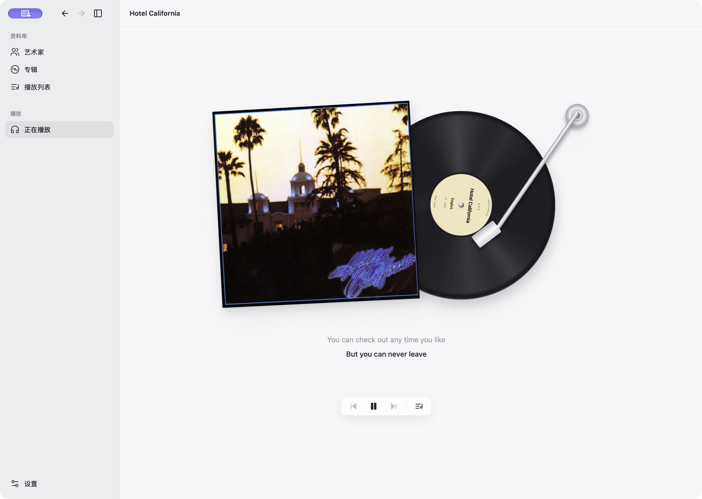
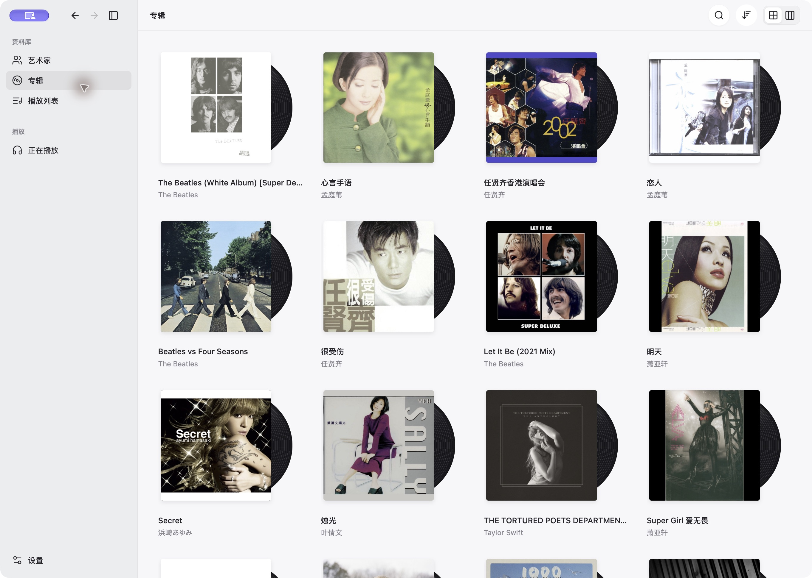
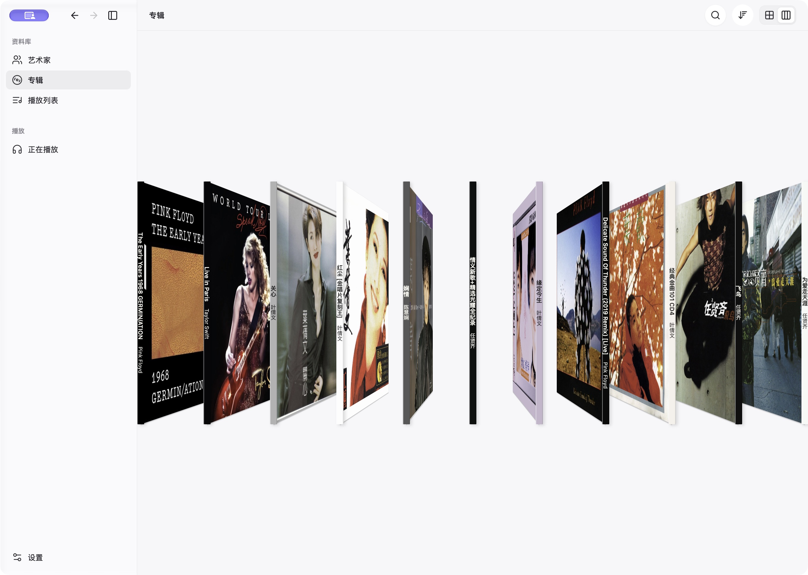
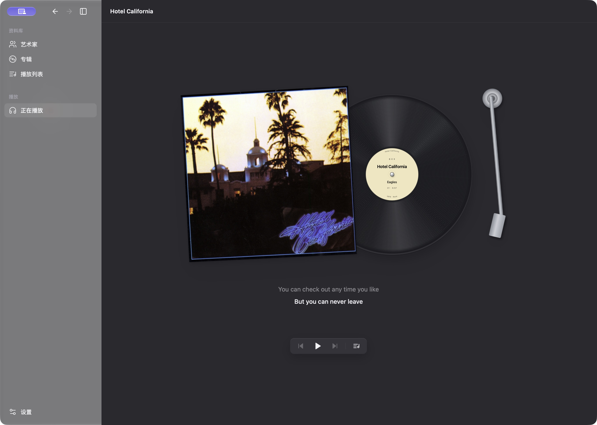
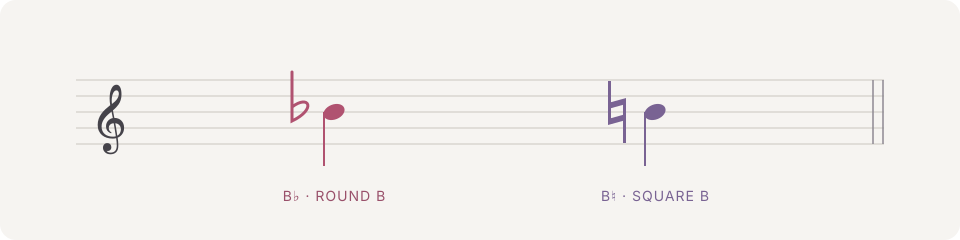

<p align="center">
  
</p>
<h1 align="center">Bee</h1>
<p align="center"><strong>好音乐，慢慢听。</strong></p>
<p align="center">为 macOS 打造的黑胶音乐播放器。翻阅封套，拨动封脊，让音乐回到唱片上。</p>
<p align="center">
  <a href="https://github.com/Hong1495/Bee/releases/latest">下载最新版</a> ·
  <a href="#界面一览">界面一览</a> ·
  <a href="#从-b-到-bee">名字与图标</a> ·
  <a href="docs/development.md">开发指南</a>
</p>
<p align="center"><sub>macOS 12+ · Apple Silicon · React + Rust + Tauri · 开源 / MIT</sub></p>

<p align="center">
  <picture>
    <source media="(prefers-color-scheme: dark)" srcset="docs/images/now-playing-dark.png">
    
  </picture>
</p>
<p align="center"><sub>封套、唱片与歌词，留在同一个安静的画面里。</sub></p>

## 把音乐放回唱片架

Bee 连接 Mac 上的“音乐”App，也能直接播放你收藏的本地音频。沿着艺术家、专辑和自定义播放列表浏览，在封面与封脊之间切换，选一张唱片，放下唱臂。

| 浏览 | 聆听 | 日常使用 |
| :--- | :--- | :--- |
| 封面陈列与横向立体封脊 | 黑胶纹理、自然光泽与进度唱臂 | 浅色、深色与跟随系统 |
| 艺术家、专辑、全库搜索与排序 | 同步歌词，上下淡化、逐行跟随 | 原生菜单、可调侧栏与窗口导航 |
| 自定义列表与自动拼合封面 | 专辑、列表与单曲播放队列 | 封面与歌词缓存限额、应用内更新 |

## 界面一览

**封面 · 像翻阅收藏一样找音乐**



**封脊 · 一格一格，拨动唱片架**



<details>
<summary>查看深色播放界面</summary>



</details>

<sub>以上为正在运行的 Bee 0.1.10 实机截图，截于 2026-11-11；左上角紫色标记是 macOS 截屏时的窗口共享指示，不属于 Bee 界面。歌曲与封面仅用于展示，版权归各自权利人所有。</sub>

## 从 B 到 Bee

**Bee 与字母 B 同音，图标的灵感来自乐谱里的「方 b」。**

中世纪记谱用两种 b 区分音高：圆润的 **b rotundum** 表示降 B，逐渐演变为降号 **♭**；方正的 **b quadratum** 表示本位 B，也是今天还原号 **♮** 的历史来源。Bee 取方 b 的轮廓，保留一点手写的自然感，把这个小小的音乐符号作为自己的标记。

<p align="center">
  
</p>
<p align="center"><sub>同一个谱位，先降 B，再还原 B。两个符号，一点音高的变化。</sub></p>

这对符号也藏在交互里：悬停专辑时是 B♭，封脊换格时是 B♮。两段短提示音为原创合成，可在设置中关闭。

<sub>记谱史参考：[赫尔辛基艺术大学 · Chromatic symbols](https://sites.uniarts.fi/web/musiikin-teoria-1/notation/chromatic-symbols)。上图为现代记谱示意，并非历史字形复刻。</sub>

## 开始聆听

从 [GitHub Releases](https://github.com/Hong1495/Bee/releases/latest) 下载 Apple Silicon（arm64）DMG，将 **Bee.app** 拖入“应用程序”，然后在 **设置 → 音乐库** 选择来源：

| 来源 | 可以播放什么 | 如何连接 |
| :--- | :--- | :--- |
| **Apple Music / 音乐 App** | 本机 Music 资料库中的本地音乐，以及已加入资料库的订阅歌曲 | 连接后允许 Bee 控制“音乐”App；订阅内容由 Music 播放 |
| **本地文件夹** | MP3、FLAC、AAC / M4A（含 ALAC）、WAV、AIFF、Ogg Vorbis | 选择一个或多个目录，由 Bee 扫描并直接播放，不复制或修改原文件 |

每次启用一个音乐库。切换来源会停止播放、清空当前队列，保留配置与缓存。Music 授权由 macOS“隐私与安全性 → 自动化”管理，无需向 Bee 提供 Apple ID 密码或开发者令牌。

Bee 会记住侧栏开关、频道列表展开状态、最后浏览的页面、专辑或播放列表、搜索、排序与滚动位置。重开时等待音乐库加载后恢复；音乐队列与进度保留，电台保留频道和音量，均不会自动播放。鼠标悬停产生的临时侧栏预览不会被保存。

开启自动检查更新后，发现新版会在窗口红绿灯右侧显示橙色下载按钮，也可以从系统菜单或设置中手动检查。更新经过签名校验，安装后确认重启即可。

> Bee 仍处于早期开发阶段。目前未接入 Spotify 和 Apple Music 完整在线目录；本地播放不支持 DRM 文件。发行包尚无 Apple Developer ID 签名与公证，更新包的独立签名校验不等同于 Apple 公证。

## 古典电台

侧栏「正在播放」下方可直接进入古典电台，无需连接音乐库或 Apple Music 订阅。提供综合古典、宁静钢琴、室内乐与舒缓古典四个 YourClassical 直播频道。频道在侧栏选择，播放页以参考维也纳金色大厅的原创矢量场景呈现，并适配明暗外观。

直播不支持选曲或拖动进度；停止后再次播放会回到当前直播。网络中断会有限重试，节目可能含主持或赞助信息。服务可用性受来源和网络影响，测试记录及来源说明见 [古典电台](docs/classical-radio.md)。

## 关于歌词与数据

- **歌词**：LRCLIB 与网易云交叉查找同步歌词，lyrics.ovh 补充纯文本；可调整来源和顺序。查询会将歌曲信息发送给启用的歌词源，匹配核对歌名、歌手、版本与时长，没有时间轴时不模拟滚动。
- **缓存**：封面和歌词合计默认上限 512 MB，可查看占用或清理。原始音乐、应用本体和系统 WebKit 数据不计入此限额。
- **资料库**：音乐来自你连接的 Music 或所选文件夹，移除文件夹不会删除原文件。仓库不提供音乐下载，也不附带示例音频资料库。

<details>
<summary>当前边界与实现细节</summary>

- 本地播放使用 Rust **rodio / Symphonia**；Music 集成使用 **Apple Events / JXA**，控制本机“音乐”App。
- Bee 按来源快照管理队列：专辑／列表从头播放，点曲目从选中位置继续，右键可仅播放一首。不复现 Music 的私有队列及随机／循环行为，目前不支持无缝播放。在 Music 中另选歌曲会退出 Bee 原有队列。
- Music 资料库读取和状态回报速度取决于库规模与 Music 响应；本地格式支持取决于文件的实际编码。
- [LRCLIB](https://lrclib.net/docs) 精确查找失败后会搜索候选；网易云使用非官方 Web 接口，覆盖率与长期可用性不作保证。[lyrics.ovh](https://github.com/NTag/lyrics.ovh#api) 仅补充纯文本。纯音乐及未匹配到歌词时保持留白；未找到或网络失败时，可在播放页右键选择“重新查找歌词”。
- 封面缓存有效期为 30 天。2048 像素以内的 JPEG / PNG 保留源文件，更大图片采用高质量缩放缓存。
- 系统图标使用 Icon Composer 资源，默认白底；暗色与透明图标由支持相应外观的 macOS 管理。图标主体经 AI 辅助生成。

</details>

## 开发与贡献

使用 **React 19 + TypeScript + Rust + Tauri 2**。在 macOS 上安装 Node.js 22+、Rust stable 与 Xcode Command Line Tools 后：

```sh
npm ci
npm run tauri -- dev
```

构建、验证命令和项目结构见 [开发指南](docs/development.md)，打包与更新签名见 [发布指南](docs/releases.md)。

欢迎提交 [Issue](https://github.com/Hong1495/Bee/issues) 或 Pull Request。反馈问题时请附 macOS / Bee 版本与复现步骤；日志和截图请先去除个人信息。

## 许可

代码以 [MIT License](LICENSE) 开源。截图中的专辑封面、歌词及第三方商标不适用本项目的 MIT 许可，相关权利归各自所有者。Bee 是独立项目，与 Apple 或其他音乐服务没有隶属关系。
